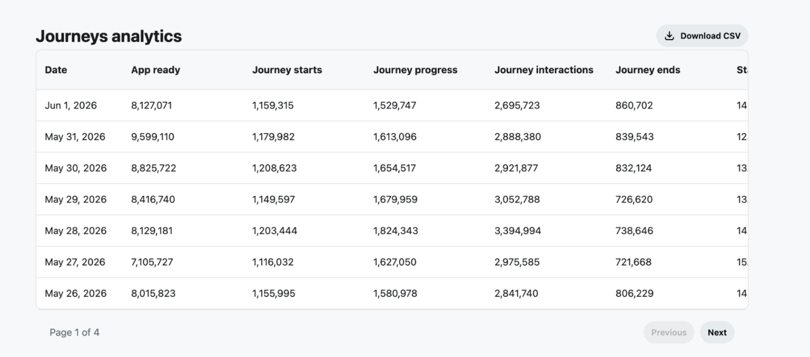
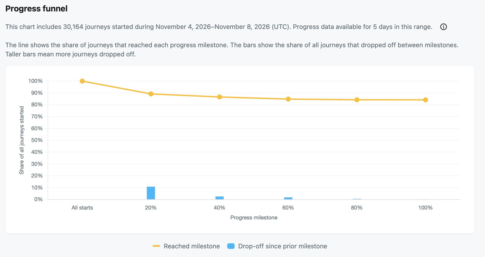

# Journeys Dashboard

Once you’ve implemented [Devvit Journeys](./devvit-journeys.md), you’ll be able to see how users are engaging with your app. You’ll find Journeys analytics on the App Details page, under the Analytics tab.

## Metrics

Journey metrics are displayed in a dedicated section below the existing engagement metrics.

You can download a CSV of your daily Journey metrics over a 30-day lookback period.

### Understanding your data

Journey analytics data is aggregated into a single record per app per UTC day. This data helps you understand the user’s experience of your app. At a high level:

- **Start Rate**: Are users engaging with my app?
- **Completion Rate**: Are users successfully finishing the game?
- **Sessions per User**: Are users coming back?
- **Median Session Duration**: How much time are users spending in my app?
- **Journey Progress & Interaction Events**: Where are users engaging or getting stuck?

### Journeys insights

Raw event counts show overall Journey activity and usage volume.

Rate- and duration-based metrics help developers evaluate Journey adoption, engagement, and completion, making it easier to identify trends and diagnose issues.

| Metric                              | What it tells you                                                                                                                                                                      |
| ----------------------------------- | -------------------------------------------------------------------------------------------------------------------------------------------------------------------------------------- |
| **utc_day**                         | Lets you analyze app performance over time and identify trends, regressions, or the impact of releases.                                                                                |
| **app_ready_count**                 | Shows how often the app was successfully loaded and available to users. Serves as the baseline for measuring adoption.                                                                 |
| **journey_start_count**             | Indicates how many times users began your game. Helps measure interest and discoverability of your app’s entry points.                                                                 |
| **journey_progress_count**          | Reveals how actively users move through your app. Sudden drops may indicate friction or confusing steps.                                                                               |
| **journey_interaction_count**       | Measures user engagement within your app. Helps identify whether users are actively interacting or passively abandoning flows.                                                         |
| **journey_end_count**               | Shows how many users reached an end state. Useful for understanding overall throughput and completion volume of your game.                                                             |
| **start_rate**                      | Measures the percentage of app loads that result in a user starting the game. Helps evaluate whether users are discovering and choosing to engage with your app.                       |
| **completion_rate**                 | Measures the percentage of times a user has started your game and successfully reached completion. Helps identify drop-off problems and assess the effectiveness of your app’s design. |
| **sessions_per_day**                | Shows how frequently users engage with your app on average. Helps distinguish between occasional use and repeat engagement.                                                            |
| **median_session_duration_seconds** | Indicates how long users typically spend in your app. Helps assess game complexity, engagement depth, and the impact of changes to the game flow.                                      |

## Progress funnel

The Progress funnel shows how far started Journeys progress through your app. It appears below the daily metrics table when progress data is available.

The chart combines Journey starts across the dates with progress data. Its summary shows the number of starts included, the UTC date range, and how many days in that range have progress data. Progress is counted from the day a Journey starts and the following day (UTC); dates without progress data are omitted.

- The line shows the share of all Journeys started that reached each progress milestone you’ve set in your app. “All starts” is the 100% baseline.
- The bars show the share of all Journeys started that dropped off between the previous milestone and the current one. Taller bars indicate more drop-off.
- Hover over a milestone to see the number of Journeys reached and its share of all starts. Hover over a drop-off bar to see the count and share that dropped off since the previous milestone.

If progress data is not yet available for the included dates, the chart explains that and daily activity remains available in the table above. If no Journeys reached a milestone above 0%, the chart reports that there are no positive milestones to show.
